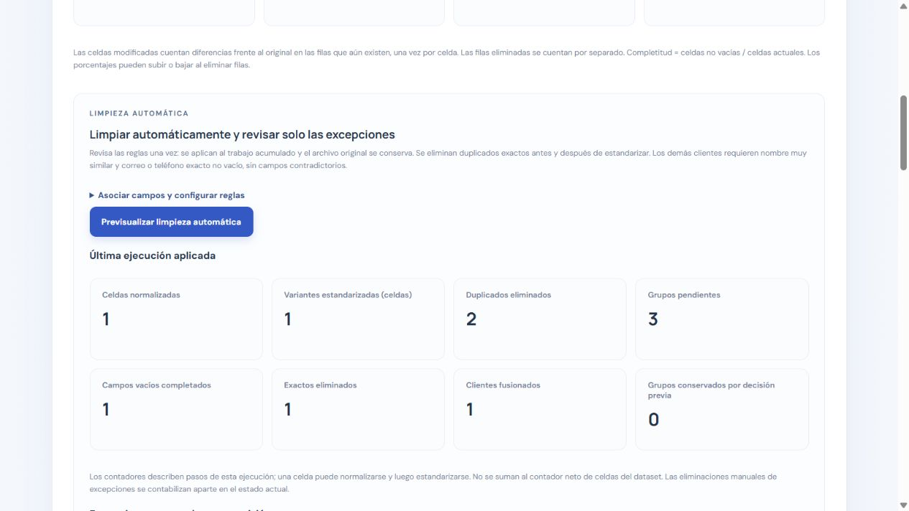

# Verificación de Limpieza automática — 17 de noviembre de 2026

Se reutilizó el estado de trabajo y las revisiones de CleanDataBot. El motor nuevo está separado en `backend/auto_cleanup.py`; la integración y el commit permanecen en `backend/main.py`. React incorpora configuración, previsualización, resumen, excepciones por grupos y auditoría sin sustituir los módulos manuales.

## Resultado real de verificación

- Suite completa: **58 pruebas aprobadas**, 0 fallos y 0 errores. La última ejecución de unittest reportó 2,225 segundos para las pruebas, sin contar inicio del proceso.
- Se conservaron las 35 pruebas del flujo anterior y se añadieron 23 de limpieza automática y contrato HTTP.
- `npm run build`: TypeScript y Vite correctos; Vite 8.3.0 transformó 22 módulos y reportó 260 ms para su fase de build.
- La integración existente de Starlette/TestClient emite un aviso de deprecación de httpx; las pruebas HTTP se ejecutaron correctamente.
- Se verificó el flujo en el navegador local: `http://127.0.0.1:5173` → FastAPI en `127.0.0.1:8000` → versión de trabajo → resumen y CSV.
- La consulta de consola del navegador para niveles error/warn devolvió una lista vacía durante ese recorrido.

## Ejemplo reproducible observado

Se cargó `frontend/public/clientes_automatico_demo.csv` mediante **Ejemplo de limpieza automática**. Es un CSV ficticio de nueve registros con encabezados `full_name`, `email`, `phone`, `document` y `city`.

Las asociaciones sugeridas fueron correctas. Se configuró en `city` el reemplazo explícito `BOGOTA` → `Bogotá` y se conservaron las opciones de recorte y reducción de espacios.

La previsualización y la aplicación mostraron los siguientes resultados calculados:

| Indicador de la ejecución | Resultado |
|---|---:|
| Celdas normalizadas | 1 |
| Celdas estandarizadas | 1 |
| Exactos eliminados | 1 |
| Clientes absorbidos por regla segura | 1 |
| Total de duplicados eliminados | 2 |
| Campos vacíos completados | 1 |
| Grupos pendientes | 3 |
| Filas actuales | 7 |

El registro original 1 quedó como `Ana María Pérez`, con ciudad `Bogotá` y el teléfono que antes estaba vacío completado desde el duplicado compatible. Las otras eliminaciones fueron del duplicado exacto original y del cliente compatible, siempre conservando la primera aparición.

Los tres grupos restantes fueron:

- Andrea López / Andrea Lopez: correos, teléfonos y documentos diferentes.
- Carlos Ruiz / Carlos Ruis: contactos vacíos y documentos distintos; los vacíos no autorizaron una fusión.
- Laura Díaz / LAURA DIAZ: correo y teléfono compartidos, pero documentos contradictorios.

Se usó **Son diferentes: conservar todos** para cada grupo. Una segunda previsualización mostró **cero** celdas normalizadas, estandarizadas o completadas y **cero** eliminaciones; reconoció tres grupos previamente conservados. Se aplicó también ese plan sin cambios y se descargó el CSV de trabajo.

La descarga `clientes_automatico_demo_corregido.csv` se abrió desde disco y confirmó siete filas, el teléfono completado, las personas distintas conservadas y únicamente las cinco columnas originales. Las pruebas también comparan el DataFrame original antes/después, rechazan reenvíos de planes y comprueban que la exportación repetida no cambia datos ni métricas.



## Cobertura relevante

`backend/test_auto_cleanup.py` cubre:

- Duplicados reales compatibles y llenado exclusivo de vacíos.
- Nombres parecidos sin contacto coincidente; contactos vacíos y nombres ausentes o no textuales.
- Identificadores, correo, teléfono y otros campos contradictorios.
- Duplicados exactos iniciales y creados tras estandarizar.
- Reglas limitadas a una columna; cadenas explícitas de canónicos e idempotencia.
- Componentes transitivos que no deben fusionarse.
- Donantes contradictorios que no deben completar parcialmente al superviviente.
- Asociaciones ausentes o ambiguas y mensajes de omisión.
- Ciclos, canónicos contradictorios y configuraciones inválidas sin cambios parciales.
- Revisión de excepciones y recalculado de grupos tras eliminar un puente.
- Decisiones de conservar todos respetadas en ejecuciones posteriores, incluso si se cambia la configuración para permitir más fusiones.
- Planes obsoletos, reenvíos y fallo de métricas sin publicar estado parcial.
- Convivencia con correcciones manuales y conservación de identificadores estables.
- Contratos HTTP de carga, configuración, previsualización, aplicación, revisión y CSV final.

## Comprobación puntual de tamaño

Se ejecutó la previsualización automática una vez para 50, 500 y 2.000 filas del generador ya existente en `backend/benchmark.py`. Datos sintéticos de seis columnas, ocho variantes de ciudad, cien bases de nombre, contactos y duplicados conocidos. Se usó la configuración sugerida, sin reemplazos canónicos adicionales. La comprobación midió únicamente el manejador de previsualización con `time.perf_counter`, sin red ni renderizado.

| Filas | Segundos observados | Exactos eliminados propuestos | Grupos pendientes |
|---:|---:|---:|---:|
| 50 | 0,0180 | 2 | 1 |
| 500 | 0,2674 | 29 | 1 |
| 2.000 | 5,3743 | 117 | 1 |

En este generador los contactos restantes no justifican fusiones automáticas de clientes. Los nombres relacionados se agrupan para revisión sin declararlos la misma entidad. El peor caso de muchos nombres similares sigue requiriendo comparaciones cuadráticas; se normalizan y preparan valores una vez y se limita la caché de comparaciones de nombre. No se recortan filas ni candidatos para obtener estos resultados.

Estos datos son una comprobación local única, no una mediana, un benchmark controlado ni una promesa de capacidad superior a 2.000 filas. La demora se presenta mediante el estado de procesamiento y los controles permanecen bloqueados hasta finalizar.

Código usado desde el directorio `backend`:

```python
import time
from benchmark import dataset
from main import analyses, create_state, auto_cleanup_config, AutoCleanupRequest, preview_auto_cleanup

for size in [50, 500, 2000]:
    analyses['benchmark'] = create_state(dataset(size), 'benchmark.csv')
    config = AutoCleanupRequest(**auto_cleanup_config('benchmark')['config'])
    start = time.perf_counter()
    report = preview_auto_cleanup('benchmark', config)
    print(size, time.perf_counter() - start, report['counts'])
    analyses.clear()
```

## Comandos

```powershell
cd backend
./.venv/Scripts/python.exe -m pip install -r requirements-dev.txt
./.venv/Scripts/python.exe -m unittest discover -v
```

```powershell
cd frontend
npm ci
npm run build
```

Los límites y la configuración de las reglas están documentados en el apartado **Limpieza automática** del README. Se aplicó la revisión de React para mantener tipos compartidos, controles etiquetados, cancelación de la carga de configuración, guardia contra dobles envíos y uso del bloqueo y los errores HTTP existentes. No se realizó despliegue ni publicación de estos cambios.
